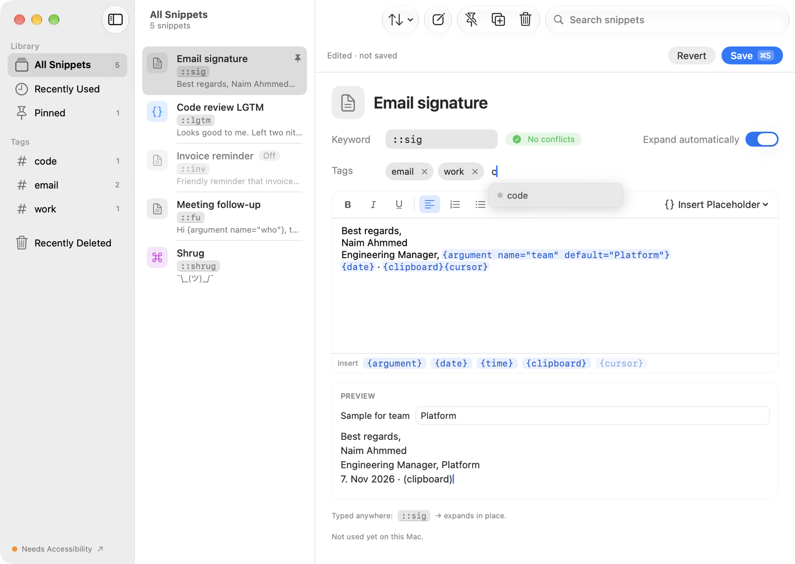
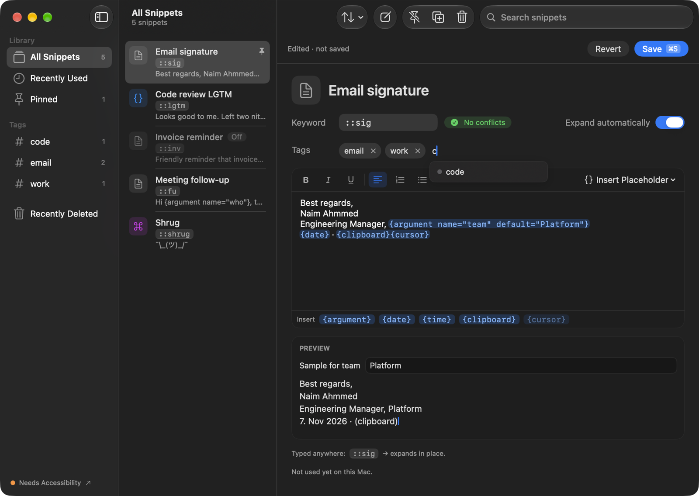
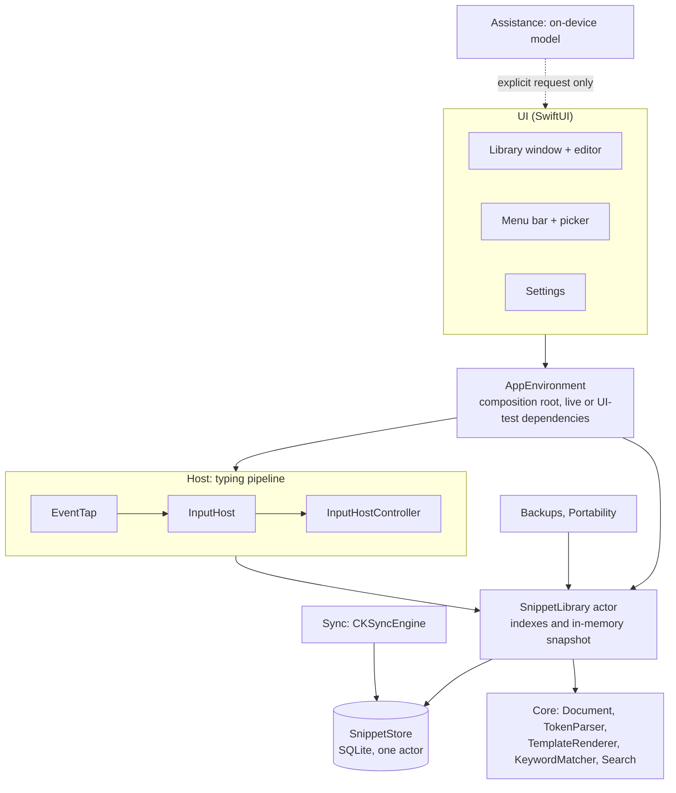
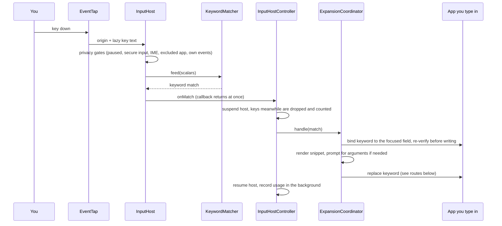
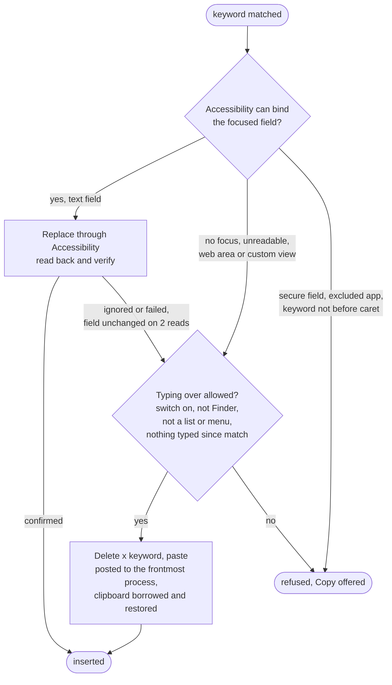

# Keyloom

A macOS menu-bar text expander. Type a keyword such as `::sig` in any app and Keyloom replaces it with a snippet: rich text, dates, clipboard, prompted arguments and a cursor position. Snippets stay on your Mac; iCloud sync is optional and off by default.

- **Requires** macOS 26 or later, Apple Silicon. Swift 6, no third-party dependencies.
- **One permission:** Accessibility. No Input Monitoring, no Post Events.
- **Bundle id** `com.thenaim.keyloom`.

## Screenshots

<p align="center">
  
  
</p>

The library window: tags and status in the sidebar, snippet rows with keyword chips and one-line previews, and an editor with token pills, a live "Expands to" preview, keyword-conflict check and usage line. A menu-bar popover gives quick insert, pause and a permission banner; Settings has General, Expansion, Sync and Assistance.

## Snippets

Templates support these tokens:

| Token | Result |
|---|---|
| `{date}` `{time}` (with an optional `format`) | current date / time |
| `{uuid}` | a fresh UUID |
| `{clipboard}` | current clipboard text, read only when a snippet uses it |
| `{argument name="…" default="…"}` | asked for in a prompt before inserting (can offer choices) |
| `{cursor}` | where the caret lands after insertion |

Bold, italic, underline and lists are kept where the destination takes styled text. A keyword matches the moment its last character is typed (no delimiter). The picker (default `⌃⌥Space`) and the menu bar insert a snippet without typing its keyword. Raycast snippets can be imported; snippets export to a native format. Daily snapshots back up the library.

## Install and develop

```sh
scripts/install.sh      # build Release and install to /Applications
scripts/build.sh        # build only, prints the .app path
```

After the first install, grant **Accessibility** in System Settings → Privacy & Security (the Expansion tab has the button). The install script signs the ad-hoc build with a designated requirement on the bundle id, so the grant survives rebuilds.

Unit tests:

```sh
xcodebuild test -project Keyloom.xcodeproj -scheme Keyloom -destination 'platform=macOS' \
  -derivedDataPath /tmp/keyloom-dd ENABLE_TESTABILITY=YES SWIFT_OPTIMIZATION_LEVEL=-Onone \
  -only-testing:KeyloomTests
```

UI journeys run from the `KeyloomUITests` scheme against inert OS boundaries (no tap, hotkey or permission needed). `scripts/release/release.sh --help` documents the Developer ID release; `scripts/profile/profile.sh --help` the idle profile.

## Architecture

### Layers



`SnippetLibrary` is the only app-facing data API. After every committed write it reloads, rebuilds the keyword and search indexes and swaps the keyword index into `KeywordIndexStore`. The matcher reads that store directly, so typing never waits on the database.

### From keystroke to expansion



### Insertion routes



The Accessibility route verifies every step and fails closed. The typing route cannot read the field back, so it is bounded by guards instead and reports its insertions as unverified.

## Privacy

- Keys are matched in memory over a buffer capped at the longest keyword. Typed text, snippet text and clipboard contents are never stored or logged; logs and counters hold outcome names only.
- No keys are read while secure input is on, while an input method is composing, in excluded apps, or in Keyloom itself.
- The clipboard is touched only for the typing route and the explicit rich-paste route, tagged transient so clipboard managers skip it, and given back only while it is still Keyloom's.
- Sync, when enabled, uses your private iCloud database. Writing assistance runs on-device and only on text you select.

## Status

iCloud sync needs a build signed with a CloudKit entitlement and a provisioned container; builds made with `scripts/install.sh` report "not signed for iCloud". The typing route is covered by unit tests with fakes; behavior in particular apps (browsers, Electron, terminals) has to be checked by hand.

## App icon

The icon is an Icon Composer file, `Icon/AppIcon.icon` ("Weave", all looks: default, dark, tinted, clear). `tools/make_icon.sh` compiles it with `actool` into `Resources/` (review only; the Xcode build bundles it), and `tools/icon_review.sh` renders a contact sheet of every look. The menu-bar glyph is a template image with a badge variant when Accessibility is missing.
