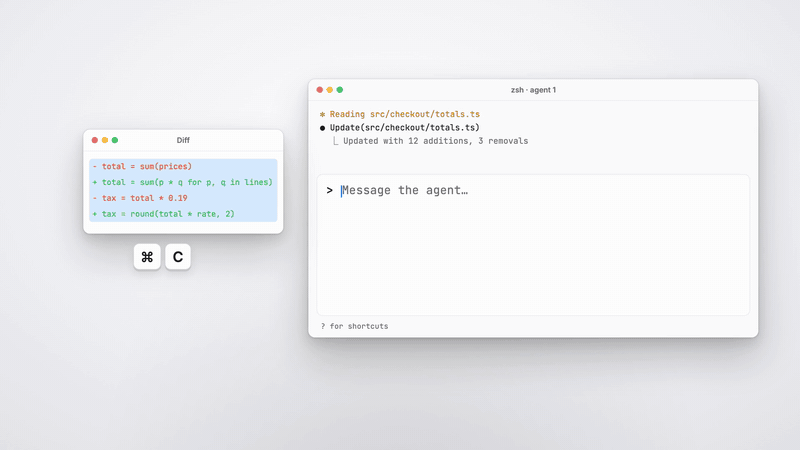
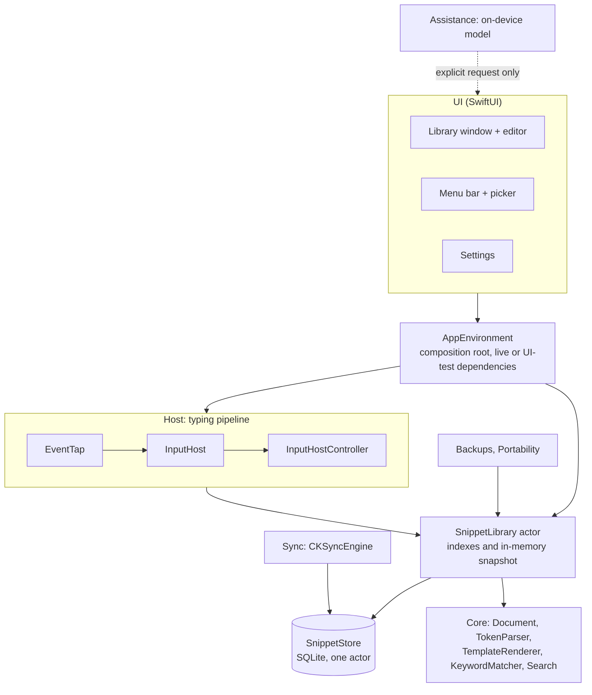
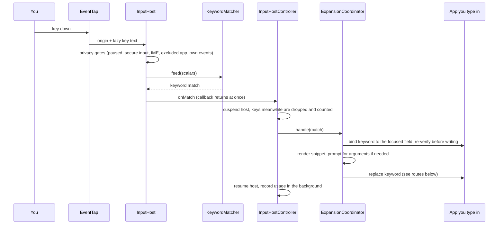
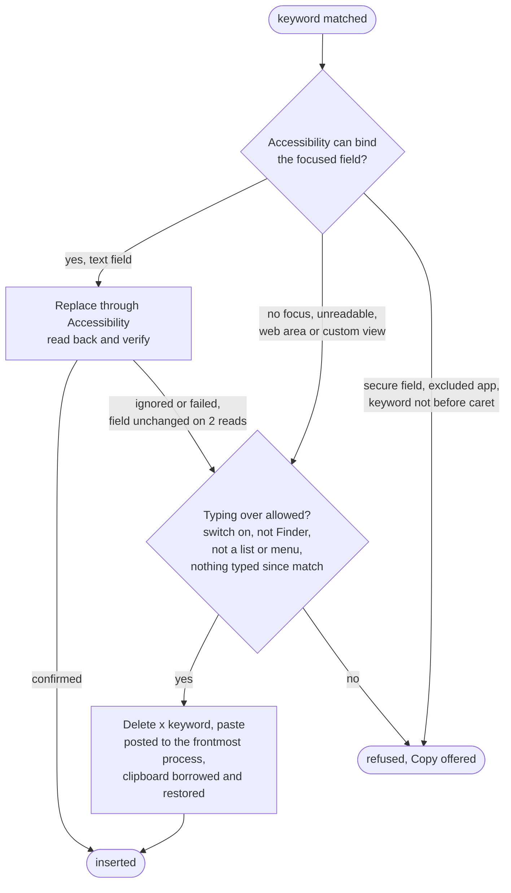

# Keyloom

<p align="center">
  <br>
  <a href="docs/media/keyloom.mp4">Watch the 30 second film with sound</a>
</p>

A macOS menu-bar text expander for the text you retype all day: AI prompts, agent instructions (plan, implement, review, ship), replies and signatures. Type a keyword such as `::review` in any app and Keyloom replaces it with a snippet: rich text, dates, clipboard, prompted arguments and a cursor position. Snippets stay on your Mac; iCloud sync is optional and off by default.

[More about Keyloom](https://thenaim.com/projects/keyloom/)

- **Requires** macOS 26 or later, Apple Silicon. Swift 6, no third-party dependencies.
- **One permission:** Accessibility (no Input Monitoring). Details in [Privacy](#privacy).
- **Local first:** no account, no telemetry; text never leaves your Mac unless you turn on iCloud sync.

## What it looks like

A library window (tags, snippet rows with keyword chips, an editor with token pills, a live "Expands to" preview and a keyword-conflict check), a menu-bar popover (quick insert, pause, permission banner) and Settings (General, Expansion, Sync, Assistance).

## Example: an agent instruction you stop retyping

Keyword `::review`:

```text
Review the change below against the plan. List bugs first, then risks, then nits.
Scope: {argument name="scope" default="the whole diff"}

{clipboard}
```

Type `::review` in any text field. Keyloom asks for the scope, inserts the instruction with your clipboard (the diff or error you just copied) and puts the caret where `{cursor}` is, if you used it. The same pattern covers `::plan`, `::implement` and `::ship`.

## Install

```sh
brew install --cask tankibaj/tap/keyloom
```

Then grant **Accessibility** on first run (System Settings → Privacy & Security). To build from source instead, see [Install and develop](#install-and-develop).

## Snippets

Templates support these tokens:

| Token | Result |
|---|---|
| `{date}` `{time}` (with an optional `format`) | current date / time |
| `{uuid}` | a fresh UUID |
| `{clipboard}` | current clipboard text, read only when a snippet uses it |
| `{argument name="…" default="…"}` | asked for in a prompt before inserting (can offer choices) |
| `{cursor}` | where the caret lands after insertion |

Bold, italic, underline and lists are kept where the destination takes styled text. A keyword matches the moment its last character is typed (no delimiter). Unknown tokens stay literal and are flagged in the editor.

- **Insert without typing:** the menu bar inserts a snippet (`⌘1`…`⌘9` for the first rows, pinned and recent first). The picker (default `⌃⌥Space`, arrows, Return) copies a snippet to the clipboard.
- **Library:** tags, pins, duplicate, recently used, and Recently Deleted with restore. Library shortcuts: `⌘N` new, `⌘S` save, `⌘D` duplicate, `⇧⌘P` pin, `⌘F` find; `⌘B` `⌘I` `⌘U` format in the editor.
- **Per-app rules:** exclude apps by bundle id; expansion in apps Accessibility cannot inspect is a switch (default on). Nothing is read in secure fields.
- **Backups:** 30 daily snapshots plus 10 safeguards taken before an import or restore; restore from Settings › Sync.
- **Import and export:** native JSON. Raycast import and export are best effort (the format is assumed, and a loss report lists what could not be mapped).
- **Writing assistance (on-device, opt-in, off by default):** Proofread, Shorten or change tone (professional, friendly, casual) of selected prose, with placeholders preserved. It uses Apple's on-device model; nothing is sent to a server.

## Install and develop

```sh
scripts/install.sh      # build Release and install to /Applications
scripts/build.sh        # build only, prints the .app path
```

After the first install, grant **Accessibility** in System Settings → Privacy & Security (the Expansion tab has the button). The install script signs the ad-hoc build with a designated requirement on the bundle id, so the grant survives rebuilds.

Unit tests:

```sh
xcodebuild test -project Keyloom.xcodeproj -scheme Keyloom -destination 'platform=macOS' \
  -derivedDataPath /tmp/keyloom-dd ENABLE_TESTABILITY=YES SWIFT_OPTIMIZATION_LEVEL=-Onone \
  -only-testing:KeyloomTests
```

UI journeys run from the `KeyloomUITests` scheme against inert OS boundaries (no tap, hotkey or permission needed). `scripts/release/release.sh --help` documents the Developer ID release; `scripts/profile/profile.sh --help` the idle profile.

## Release and install

Bump `MARKETING_VERSION` in the pbxproj and push to main: `.github/workflows/release.yml` (skipped when `v<version>` already exists) builds, ad-hoc signs (no notarization), publishes `Keyloom-X.Y.Z-arm64.zip` + `.sha256` as a GitHub Release (the tag `vX.Y.Z` is created by the release, after a successful build) and bumps the cask in `tankibaj/homebrew-tap`. CI (`ci.yml`) builds and runs the unit tests on push to main and PRs.

```sh
brew install --cask tankibaj/tap/keyloom
```

Grant Accessibility on first run. The release is ad-hoc signed and not notarized; see `packaging/homebrew/README.md`.

## Architecture

### Layers



`SnippetLibrary` is the only app-facing data API. After every committed write it reloads, rebuilds the keyword and search indexes and swaps the keyword index into `KeywordIndexStore`. The matcher reads that store directly, so typing never waits on the database.

### From keystroke to expansion



### Insertion routes



The Accessibility route verifies every step and fails closed. The typing route cannot read the field back, so it is bounded by guards instead and reports its insertions as unverified.

## Privacy

- Keys are matched in memory over a buffer capped at the longest keyword. Typed text, snippet text and clipboard contents are never stored or logged; logs and counters hold outcome names only.
- No keys are read while secure input is on, while an input method is composing, in excluded apps, or in Keyloom itself.
- The clipboard is touched only for the typing route and the explicit rich-paste route, tagged transient so clipboard managers skip it, and given back only while it is still Keyloom's.
- Sync, when enabled, uses your private iCloud database. Writing assistance runs on-device and only on text you select.

## Status

Version `0.0.2`. iCloud sync needs a build signed with a CloudKit entitlement and a provisioned container; builds made with `scripts/install.sh` report "not signed for iCloud". When Accessibility cannot read or write a field (browsers, Electron, terminals), Keyloom falls back to typing over the keyword with a paste, which it cannot verify. That route is covered by unit tests with fakes; behavior in particular apps has to be checked by hand.

## App icon

The icon is an Icon Composer file, `Icon/AppIcon.icon` ("Weave", all looks: default, dark, tinted, clear). `tools/make_icon.sh` compiles it with `actool` into `Resources/` (review only; the Xcode build bundles it), and `tools/icon_review.sh` renders a contact sheet of every look. The menu-bar glyph is a template image with a badge variant when Accessibility is missing.
