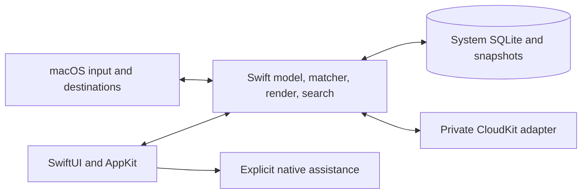

# Keyloom MVP
**Status:** In Progress | **Owner:** harnex | **Updated:** 2026-11-06 23:24

- [ ] Complete the native feasibility gate on the Swift-only baseline (WP1).
- [ ] Deliver the local core, persistence, input host and native interfaces (WP2–4).
- [ ] Deliver portability, recovery, private sync and policy-aware assistance (WP5–6).
- [ ] Complete independent validation, correctness and native UI reviews, profiling and release evidence (WP7).

Settings: Plan: doc · Tier: full · Reviewer: default · UI: yes  
UI scope: both. The library, editor, picker, pinned menu, argument prompt and full Settings are native interactive surfaces.
Goal: Turn a named formatted snippet or an immediately completed keyword into safe insertion in the original Mac app, offline first. Apple Silicon, macOS 26.0+, Xcode 27 SDK.
Inputs: Snippet-App-Plan.md:7–73 supplies the product, architecture and acceptance. Keyloom.html:74–76,138–140,186–190,209–210,236 supplies the selected design (complete). Full Settings required.
Stack: pure Swift 6 / Xcode / SwiftUI / AppKit. Native model, matcher, render and search; system SQLite via the SDK's `import SQLite3`; Foundation Codable JSON; UTF-16 offsets (validated on scalar boundaries) at the native text boundary. No Rust, Cargo, C ABI or FFI. Reuse: split view, menus, AppKit text, AX, pasteboard, CKSyncEngine, optional Foundation Models; follow mac-design.
Delivery: together, gated once on the merged change; no remote delivery in development. Slices stay under ~400 authored lines with tests; re-split before writing. Scheduling and worktrees: docs/plan/keyloom-parallel-delivery.md. Paths in WPs are repo-relative, marked (existing) or (proposed).
Context (existing, independent runs on macOS 27.2, Cargo absent): clean Release `Keyloom` 2/2 (KeyloomTests/AppIdentityTests) and `KeyloomProbe` 44/44 (Feasibility/ProbeTests: Recognizer 11, Engine 27, CloudProbe 6); binary minos and bundle minimum 26.0 (Build/Base.xcconfig:3; Swift 6.0 :6; warnings as errors :7). Probe uses Swift 5 language mode (warnings as errors); shipping target Swift 6, both pure Swift minimum 26.0. Swift-only baseline snapshot `.git/keyloom-swift-baseline.tgz` SHA256 `f768172af7d3e1e2c72df85e4fa8ea7a123608b18998b31bb6587885f92944f3`. Pending: actual macOS 26 and hardware. Commands from Keyloom.xcodeproj shared schemes `Keyloom`, `KeyloomProbe`.
Checks: `xcodebuild -project Keyloom.xcodeproj -scheme <Keyloom|KeyloomProbe> -configuration Release -destination 'platform=macOS,arch=arm64' test`; impacted adds `-only-testing:<Target>/<Class>/<test>`; typecheck/build is the same with `build`. Lint: n/a (none configured, NOT VERIFIED). No dev server; smoke (proposed) launches the Release .app and opens its menu and picker. New files need explicit pbxproj registration (no synchronized groups): integration owner only.
Red-check base: a924be4 is a historical bootstrap that predates the Swift conversion and is not a base. No history rewrite and no extra commit without Naim's authorization. Base = a Swift-only snapshot recorded at integration (a commit SHA if authorized, else a content-hashed throwaway export of the tracked and untracked source). Each slice lists stub seams (compiling, neutral returns); validator adds only new tests plus seams to the base and needs XCTest assertion failures, not compile errors.
Gate: synthetic fixture text and a disposable cloud record. Test live focus and cancellation in real destinations. A destructive replacement, exposed secure input, failed integration or missing mandatory proof blocks WP2. Record FAILED or NOT VERIFIED and request a decision. Raycast and simulated destinations confer no pass. Naim deferred the live CloudKit proof; WP2 starts only on complete GO or Naim's explicit waiver naming the missing proof. Deferral alone keeps the gate closed.
Blast radius: Keyloom app → Swift model/matcher/render/search → SQLite (SDK), versioned exports, private CloudKit. Cloud and assistance each have an independent per-device gate (Snippet-App-Plan.md:39–55).
Risk areas: build (Keyloom.xcodeproj, Build/), data and recovery (Keyloom/Store, Backups), input/privacy (Keyloom/Host), account and policy isolation (Keyloom/Sync, Assistance).
Dependencies: Apple SDK only (SQLite3, Foundation, AppKit, CloudKit). No package manifest, so license and audit steps are n/a; adding one is a plan change.
Probe safety, resolved in WP1-A before the probe is armed on real input and carried into WP3: (1) AX writes bind to the captured target and revalidate token, text and range immediately before each mutation (Feasibility/Probe/Destination.swift:70–84 re-reads current focus). (2) Secure input is checked before event text is read (EventTap.swift:109–112 reads it first). (3) Clipboard restore never overwrites a newer change: recheck ownership at the last moment, skip and report on loss (Engine.swift:360–365 check-then-restore).
Risks: invalid focus/range can overwrite unrelated text; an account change or interrupted sync can disclose or lose snippets; an unguarded model or Writing Tools route can expose selected prose. Deny uncertain insertion, journal locally, validate policy before and after generation.
Assumptions: external prerequisites to verify: signing, private container, another account/Mac, macOS 26, managed hardware, destination apps.
Not building: deferred features in Snippet-App-Plan.md:77, a hosted service, a network endpoint.
Validation: tests first; independent red on the Swift-only base; FULL on the integrated change; fresh correctness review; then native UI review. Ignored artifacts, secret scan, no dependency audit unless a package appears; external evidence recorded separately.

## Done checks
- [ ] §1 selected design → compare library, picker, icon and pinned menu with Keyloom.html:74–76,138–140,186–190; keyboard flow and full Settings in light, dark, Auto.
- [ ] §2 → WP1 Release evidence per destination, real keyboard/layout/IME/secure/permission cases, baseline footprint; three probe-safety tests fail on the base and pass (Snippet-App-Plan.md:69). Live CloudKit round trip stays pending.
- [ ] §3 → WP2–4 full local edit/insert/retest/delete/undo journey plus token, overlap, clipboard, fallback cases (Snippet-App-Plan.md:13–19,70).
- [ ] §4 → WP5 round-trip formats, migration/restore failure, two Macs offline/online, deletion, account/quota (Snippet-App-Plan.md:59–64,71).
- [ ] §5 → WP6–7 repeat journey on macOS 26 and 27, actual managed restrictions, selected-prose policy, keyboard and accessibility settings (Snippet-App-Plan.md:23–35,72).
- [ ] §6 → WP7 exact budgets and signed/notarized arm64 artifact after delivery authorization (Snippet-App-Plan.md:73).
- [ ] QA: malformed import leaves SQLite intact (§4); denied or changed AX target leaves text intact (§2); empty library/search is keyboard recoverable (§3); account change cannot replay another account's outbox (§4).

## Open questions
None blocking. WP2 awaits Naim's feasibility approval.

## Decisions
Native XCUITest plus manual true-input cross-app walks; synthetic evidence only. Keep the prototype's three-column library, recently used and pinned collections, quick picker and menu bar popover; native app icon matching its mark. Daily snapshots mean changed days only. Pure Swift replaces the Rust plan (Naim, approved).
